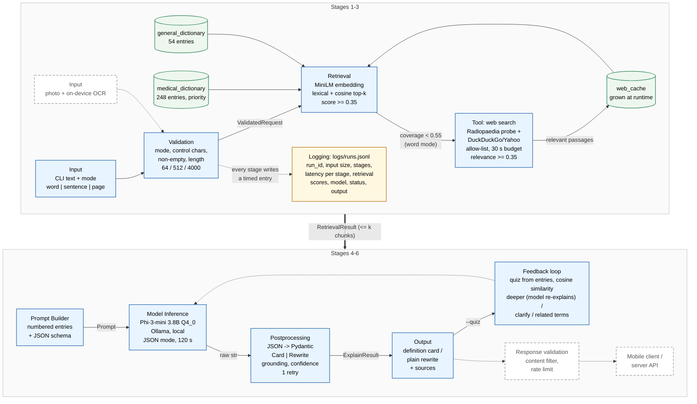

# ClinicalLingo — Prototype 1 Architecture

Solid boxes are implemented in this prototype. Dashed boxes are parts of the Part 1 design that are not built yet. Thresholds and limits are in `clinicallingo/config.py`; the contracts are in `clinicallingo/contracts.py`.

## Stage boundaries (data contracts)

All objects are Pydantic models in `clinicallingo/contracts.py`.

| Boundary | Input | Output | Missing / invalid data |
|---|---|---|---|
| CLI → Validation | `RawInput{text: str, mode: str}` | `ValidatedRequest{text, mode, char_count}` | Empty text, unknown mode, control-only text, over-limit length (64/512/4000 chars), or more than 3 words in word mode → `InputValidationError`; logged as `status=rejected_input`; nothing reaches retrieval or the model. |
| Validation → Retriever | `ValidatedRequest` | `RetrievalResult{chunks: list[Chunk] (≤ 5/8/12 by mode), coverage, used_web, web_cache_hit, web_error}` | Every chunk has `score ≥ 0.35`. Word mode with best medical score `< 0.55` and no cached passage → web tool called once (30 s hard budget); its passages must score `≥ 0.35` against the query or are dropped. Web failures never raise; recorded in `web_error`. Nothing found → `chunks=[]`. |
| Retriever → Prompt Builder | `RetrievalResult` | `Prompt{system, user, max_tokens, timeout_s, json_mode}` | Empty chunk list is legal: the prompt states "no dictionary entries were found" and asks for the `NOT_FOUND_IN_DICTIONARY` marker. |
| Prompt Builder → Model | `Prompt` | raw `str` | Timeout → `ModelTimeout` → `status=model_timeout`. HTTP/connection error (e.g. Ollama 500 "token repeat limit reached") → one retry, then `status=model_error`. Empty string → treated as parse failure downstream. |
| Model → Postprocess | raw `str` | `ExplainResult{status, card|rewrite, grounded, low_confidence, sources, fallback_text}` | Non-JSON or schema-invalid → one retry with a stricter instruction → `status=parse_failed` with `fallback_text`. Malformed `key_terms` items are dropped, not fatal. Empty retrieval or `NOT_FOUND` marker → `status=not_found`, citations discarded. Output that cites or mentions no retrieved term → `grounded=False, low_confidence=True`. |
| Postprocess → Feedback loop | `ExplainResult + RetrievalResult` | `list[QuizRound{question, reference_answer, user_answer, similarity, verdict, follow_up}]` | No chunks → no questions. Model fails to produce questions → deterministic fallback questions from the entries. Empty answer → similarity 0 → "deeper". Similarity is the max against the reference answer and the dictionary entry. |
