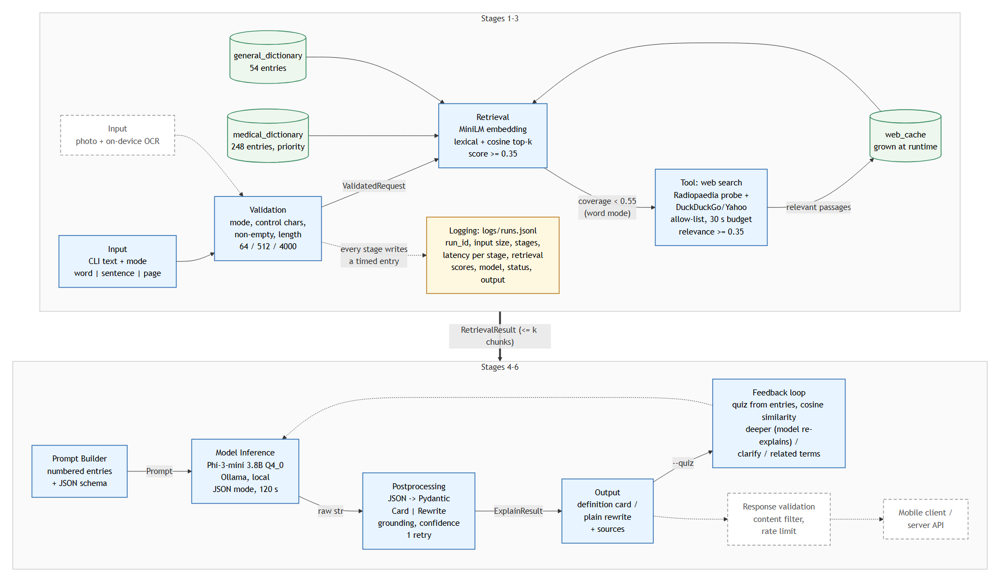

Brock Norris
ECE 6540 AI Architecture
Project Assignment 2: First Working Prototype

# Clinical Lingo: Textbook Translator Prototype 1

Code: https://github.com/BrockNorris/ClinicalLingo (README explains how to run it). Every model runs locally through Ollama.

## 1. Prototype Architecture Diagram



Solid boxes are built; dashed boxes (photo input and on-device OCR, response validation with rate limiting, the mobile client and server) are not built yet. Two things were added from the proposal feedback: an allow-listed **web search tool** whose results are cached in a second RAG index, and a **feedback loop** that quizzes the student on the retrieved content, scores free-response answers with an embedding similarity metric, and adapts the follow-up.

## 2. Working Prototype

The prototype is a command-line tool: `run explain "<text>" --mode word|sentence|page [--quiz] [--web]`. One run passes through six stages, each timed and recorded in `logs/runs.jsonl`:

1. **Validation**: checks that the command is a word|sentence|page, cleans up the text submitted, after cleaning the prompt is checked for being empty. Once the prompt is cleaned it is then checked for a character limit in order to prevent a page being truncated if it is longer than 4,000 characters (Phi-3-mini's limit) or a sentence or page taking more tokens than necessary if passed in as a word. Lastly, if text submitted as a word has more than 2 spaces in it then the user will be asked to change it to a sentence.
2. **Retrieval (RAG)**: the input is embedded with all-MiniLM-L6-v2; whole-term lexical matches and cosine neighbours (score ≥ 0.35) are gathered from a 248-entry medical dictionary (priority), a 54-entry general dictionary, and the web cache. The medical and general dictionaries is currently a seed to verify functionality.
3. **Tool call**: in word mode, if the best medical-dictionary score is below 0.55 and nothing is cached, the web tool probes Radiopaedia's article URL and searches DuckDuckGo/Yahoo restricted to an allow-list (radiopaedia.org, medlineplus.gov, webmd.com, ncbi.nlm.nih.gov, ...), fetches pages, splits paragraphs into ~500-character passages, and keeps those with similarity ≥ 0.35 to the query. Kept passages are embedded into the `web_cache` index so the next lookup never hits the web.
4. **Model inference**: Phi-3-mini (3.8B) via Ollama in JSON mode, with the retreived definitions in the prompt.
5. **Postprocessing**: the translation/result is analyzed, the extra words removed, and it is checked to make sure it includes at least some of the definitons provided. A confidence flag is attached. One retry on parse or model error.
6. **Output**, then optionally the **feedback loop** (simple agent loop): the model writes two comprehension questions from the retrieved entries; the student's free-text answer is scored by cosine similarity against the reference answer and the dictionary entry (max of the two); below 0.40 the model re-explains more simply, 0.40 to 0.58 it adds the textbook wording, at 0.58 or above it confirms and offers related terms. The cut-offs were calibrated with `examples/calibrate_quiz.py` on 39 hand-written answers (correct paraphrases scored 0.43 to 0.94, median 0.71; wrong answers 0.04 to 0.76, median 0.22).

### Example runs (full text and log lines in `docs/example_runs.md`)

**Run 1, word mode:** `run explain "hypoechoic" --mode word --quiz`

```
== hypoechoic ==
Plain:    This term describes areas on an ultrasound that look darker than their surroundings
          because they reflect fewer sound waves back.
Clinical: Hypoechogenicity refers to tissues or lesions appearing as a lower echogenicity compared
          with the surrounding structures ... (source: [1])
Synonyms: hypoechoic, hypoechogenic
Retrieved: hypoechoic (1.00, medical_dictionary), hypoechoic halo (0.42), acoustic shadowing (0.36)
Q1: What does hypoechogenicity refer to in medical imaging?
   You said:   It looks darker than the tissue around it because fewer echoes come back
   Similarity: 0.68 -> related.  Correct. Related terms you will meet nearby: ...
Q2: In what conditions do solid masses often exhibit hypoechogenicity?
   You said:   something to do with blood flow
   Similarity: 0.22 -> deeper.  Let's go deeper. ... (model re-explains from the entries)
```

Log line (trimmed):

```json
{"run_id":"...","command":"explain","mode":"word","input_chars":10,
 "stages":["validate","retrieve","build_prompt","infer","postprocess","output"],
 "latency_ms":{"validate":0.1,"retrieve":199.8,"build_prompt":0.0,"infer":1768.7,"postprocess":0.6,"output":0.0,"total":1995.5},
 "retrieval":{"k":3,"coverage":1.0,"top_score":1.0,"used_web":false,"web_cache_hit":false,"lexical_hits":["hypoechoic"],"indexes":["medical_dictionary"]},
 "model":{"backend":"ollama","model":"phi3:mini","family":"phi3","parameter_size":"3.8B","quantization":"Q4_0","retries":0,"output_tokens":121,"eval_ms":1702.8},
 "status":"ok","grounded":true,"low_confidence":false}
```

**Run 2, sentence mode:** `run explain "Sonographic findings of acute cholecystitis include cholelithiasis, gallbladder wall thickening greater than 3 mm, pericholecystic fluid, and a positive sonographic Murphy sign." --mode sentence`

```
== Plain-language rewrite ==
Ultrasound images of someone with acute cholecystitis often show gallstones (gallbladder stones),
a thickened wall more than three millimeters, fluid around the gallbladder and tenderness when
pressing directly on it.
Key terms:
  - sonographic findings: What is seen in ultrasound images
  - acute cholecystitis: Sudden gallbladder inflammation, usually due to a blockage by stones
Retrieved: sonographic (1.00), gallbladder (1.00), cholelithiasis (1.00), cholecystitis (1.00),
           sonographic Murphy sign (1.00), acute (1.00), pericholecystic fluid (1.00), wall thickening (1.00)
status=ok  grounded=true  latency_ms: retrieve 68, infer 2080, total 2248
```

**Run 3, word mode, term not in the dictionary (tool call):** `run explain "pneumobilia" --mode word`

```
== pneumobilia ==
Plain:    Pneumobilia is when air gets inside your bile ducts, which usually shouldn't happen.
Clinical: The presence of gas within the hepatobiliary tree as seen on ultrasound ...
Sources: https://radiopaedia.org/articles/pneumobilia
Retrieved: pneumobilia (0.66, web_cache)
stages: validate, retrieve, web_search, build_prompt, infer, postprocess, output
latency_ms: retrieve 10347 (web_search 10347), infer 1913, total 13071
retrieval: coverage 0.00, used_web true, web_cache_hit false, 40 passages fetched, 5 passed relevance
```

A second run of the same term shows `web_cache_hit: true`, no `web_search` stage, and a 2-second total.

## 3. Stage Interfaces (Early Data Contracts)

All boundary objects are Pydantic models in `clinicallingo/contracts.py`; the two described here are the ones most exercised by the failure test and the tool call.

**Boundary A: CLI → Validation**
- Input: `RawInput{text: str, mode: str}`, untrusted.
- Output: `ValidatedRequest{text: str (≥ 1 char), mode: "word"|"sentence"|"page", char_count: int}`. Text is cleaned (control characters removed, whitespace collapsed; paragraph breaks kept only in page mode) and within the mode's cap: 64 / 512 / 4000 characters; word mode allows at most three words.
- Missing or invalid: raises `InputValidationError` with a reason. The pipeline writes a log line with `status=rejected_input`, exits with code 2, and nothing reaches retrieval or the model.

**Boundary B: Retriever → Prompt Builder**
- Input: `ValidatedRequest`.
- Output: `RetrievalResult{chunks: list[Chunk], coverage: float, used_web: bool, web_cache_hit: bool, web_error: str|None, lexical_hits: list[str]}` where each `Chunk{term, text, source, score ∈ [-1, 1], index_name ∈ {medical_dictionary, general_dictionary, web_cache}, synonyms}`. At most k = 5 / 8 / 12 chunks by mode, every one with `score ≥ 0.35`, ordered by score times an index priority (medical 1.0, general 0.9, web 0.85). `coverage` is the best medical-dictionary score, 0.0 if none.
- Missing or invalid: an empty `chunks` list is a legal value. The prompt then states that no entries were found and asks the model for a `NOT_FOUND_IN_DICTIONARY` marker; postprocessing turns an empty retrieval into `status=not_found` and discards any citations, so the model cannot pass off its own knowledge as grounded. Web-tool failures (no results, HTTP errors, the 30-second budget) are recorded in `web_error` and never raise.

## 4. Model Choice and Assumptions

**Generation: Phi-3-mini (3.8B parameters), Ollama tag `phi3:mini`, 2.2 GB on disk.** Chosen because it matches the Part 1 proposal, runs on the hardware I have (RTX PRO 2000 laptop GPU, 8 GB VRAM), costs nothing, and the whole runtime fits on a flash drive so the prototype runs on another PC. Observed on the GPU: about 60 to 70 output tokens per second (121 tokens in 1.7 s), 1.7 to 2.1 s inference for a definition card, 2 to 7 s for a sentence rewrite; the first load from the USB drive takes one to two minutes, after which the model stays resident. **Embedding: all-MiniLM-L6-v2 (`all-minilm`, 23M parameters, 45 MB, F16)**, also through Ollama, so one runtime serves both models.

**Quantization.** Ollama's `phi3:mini` tag is 4-bit (`Q4_0`), not the Q4_K_M I had planned; the run log records the served quantization. I did not A/B against a higher-precision tag (it would have added 4 GB to a drive that writes at 3 MB/s). What I observed with Q4_0: fluent, mostly accurate text, but three distinct instruction-following failures in roughly fifteen live runs: a typo inside an otherwise correct rewrite ("gallblad0der"), one repetition loop that Ollama aborted with HTTP 500 "token repeat limit reached", and one JSON object where the model copied placeholder wording from the prompt as a key name ("short plain meaning"). Each one became a postprocessing rule (retry, `repeat_penalty 1.15`, tolerant key-term parsing).

**Two model-card style assumptions.**
1. *Inputs are English textbook prose about sonography.* The dictionaries, prompts, and lexical matching are English-only, and the embedding model was trained on general English. A term in another language, or a chemistry textbook, will retrieve weak neighbours and the output will be flagged low-confidence rather than refused.
2. *JSON-mode output is likely but not guaranteed, and mentioning a retrieved term is not the same as using it faithfully.* The system assumes the model will usually return the requested schema and will usually base definitions on the numbered entries. Postprocessing enforces the first assumption (parse, validate, retry) but can only approximate the second: the grounding check verifies that cited or mentioned terms exist in the retrieval, not that the definition's content matches the entry.

## 5. One Failure Test

**What I changed.** `run failure-test --failure malformed_json` wraps the Ollama backend in a `FaultyBackend` that ignores the prompt and returns prose ("Sure! Echogenic means that a structure reflects ultrasound waves strongly ... Let me know if you want more detail.") instead of a JSON object. This simulates the model ignoring the JSON instruction, which Phi-3-mini did for real once during development.

**Did it crash or silently produce a wrong answer?** Neither. Postprocessing raised an internal `ParseFailure` ("no JSON object found in model output"), the pipeline retried once with a stricter instruction (`infer_retry`, `postprocess_retry` appear in the stage list), the retry also failed, and the run ended with `status=parse_failed`, `grounded=false`, `low_confidence=true`, and the raw text preserved in `fallback_text`. The output shown to the student is an explicit "could not produce a structured answer" block with the raw text, not a definition card. Exit code 1.

**Which boundary let it through, and which caught it?** The Prompt Builder → Model boundary let it through: the `Prompt` contract constrains the input (`json_mode=True`, timeout, token cap) but the model's output is an unconstrained `str`, so prose is a legal value there. The Model → Postprocess boundary caught it, because that is the first place the output is typed.

**What I would add.** Constrained decoding: Ollama supports structured outputs with a JSON schema (a grammar), which would make prose impossible rather than merely unlikely, and would also have prevented the renamed-key failure. Second, a content check at the same boundary: compare the generated definition to the retrieved entry with the same embedding similarity used in the quiz, and flag low similarity as "possibly unfaithful" rather than only checking that a term is mentioned.

## 6. Gap Analysis and Next Steps

**Built:** the full text path end to end (CLI → validation → hybrid dictionary RAG → allow-listed web tool with a cached second index → Phi-3-mini → typed postprocessing with grounding and confidence → output), the quiz feedback loop with similarity scoring and adaptive follow-up, per-stage latency and structured run logs, failure injection for five fault types, and 59 offline unit tests. **Stubbed:** the medical dictionary (248 student-written entries standing in for a licensed dictionary), the grounding check (string matching, not semantic faithfulness), and "response validation" (only confidence flags; no content filter or rate limiting). **Missing:** photo input and OCR, the mobile client, the server API, illustrations, and a shared cache across users.

**Most fragile:** the Model → Postprocess boundary. A 3.8B 4-bit model's compliance with a JSON schema is probabilistic; each of the three live failures above needed its own handling rule, and the next one will too until decoding is schema-constrained. Close behind is the similarity metric in the feedback loop: a correct paraphrase scored 0.26 against the model-written reference answer until the dictionary entry was added as a second target, and my first thresholds (0.55 / 0.75) told a perfectly correct answer to "clarify" until I calibrated them on real scores. Even calibrated, cosine similarity cannot separate a topically adjacent wrong answer ("stones inside the gallbladder" for pericholecystic fluid scored 0.76) from a right one; that needs a model-graded or rubric-based check.

**To monitor this with real users** I would need, from the run log that already exists: per-stage latency percentiles (especially `infer` and `web_search`), the rates of `parse_failed`, `model_error`, `not_found`, and `low_confidence` over time, retrieval `coverage` distribution (a falling coverage means the dictionary is missing what students are reading), web-tool error rate and cache hit rate, quiz similarity distribution per verdict, and alerts on Ollama availability and model load time. The one thing the log does not capture yet is whether the student found the answer useful, which is the signal the semester's evaluation phase is meant to collect.

*Note: AI (Claude Code) was used to help write the code, curate the seed dictionary, and draft documentation for this prototype; the architecture, the design decisions, the testing, and the review of the results are mine.*
